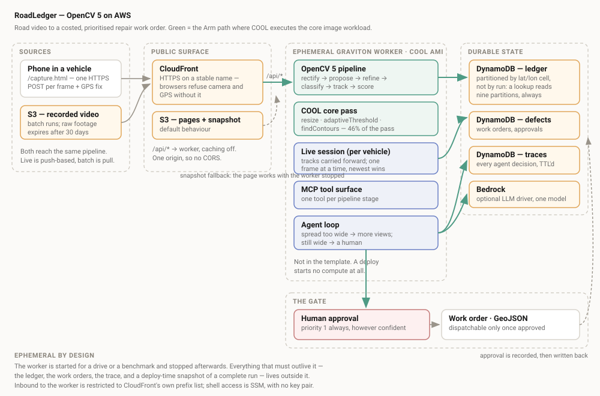
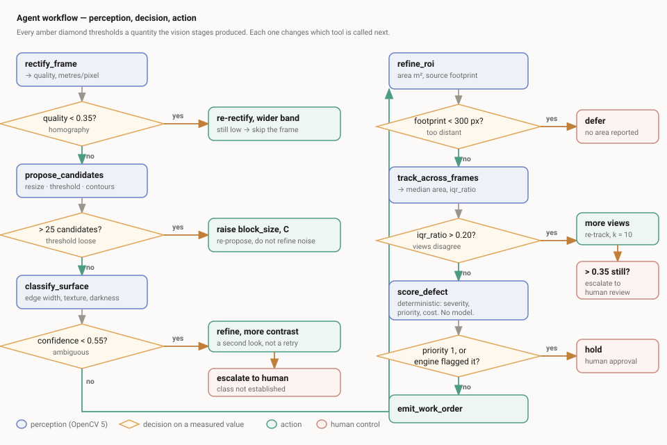

# RoadLedger — technical report

OpenCV AI Competition 2026, powered by AWS.

---

## 1. The problem, and who has it

A municipal road authority does not need to be told a pothole exists. Its
inspectors already know. What it cannot produce cheaply is the thing that
actually governs spending: **a ranked list of defects with quantities** — how
large each one is, how urgent, what it will cost to repair, and how confident
anyone should be in those figures.

Pothole *detection* is a crowded space and stops exactly where the useful work
begins. A bounding box does not tell a crew how much asphalt to load, does not
let a district compare two wards, and does not survive the question "how do you
know?". Meanwhile the single most expensive error is the one detection-only
systems make most often: dispatching a crew to a **shadow**.

RoadLedger takes dashcam video and produces a costed, prioritised work order
where every area is a measurement in square metres carrying its own
uncertainty, and anything urgent is held for a human.

**Users.** Municipal and district road maintenance teams; the engineer who
signs off the repair schedule; the auditor who asks later why a particular
stretch was prioritised.

---

## 2. Architecture

**One CloudFront distribution serves both the pages and the API.** That is not
a deployment convenience. Browsers refuse a page the camera and GPS unless it
is on a secure origin, so live phone capture *needs* HTTPS, and CloudFront
supplies it on a stable name with no certificate to buy or renew. Putting the
API behind the same distribution also means the phone page and the endpoint
share an origin, so there is no CORS at all.

Its default behaviour serves the review UI from **S3**. A `/api/*` behaviour,
caching disabled, routes to an **ephemeral Graviton worker** running the COOL
AMI, which serves the OpenCV pipeline both as **MCP tools** for the agent and
as the live measuring endpoint the phone posts frames to. Defects, work orders
and the full decision trace go to **DynamoDB**; **Bedrock** provides the
optional language-model driver; **CloudWatch** carries tool calls, timings and
rule firings.

Three consequences of the worker being ephemeral, each of which forced a design
decision rather than being absorbed quietly.

**The worker is not in the CloudFormation template.** A template that creates
an instance means a deploy starts billing, and a stack left up over a judging
window bills for every hour of it. The stack is the plumbing and
`scripts/aws_worker.sh` is the tap. Deploying the stack starts no compute.

**The review UI must work with the worker off**, which is its normal state. So
`demo.json` and `health.json` are generated at deploy time and uploaded beside
the page; the page tries the live API first and falls back. Verified with the
API entirely absent: the full run renders — defects, costs, agent trace, route
plan — above a line saying it is a snapshot and the worker is stopped. A demo
that only works while an instance is burning is not a demo.

**The cross-drive ledger cannot live in the worker.** Its entire value is that
it outlives a drive, and an in-memory ledger on a machine designed to be
stopped is not a cross-drive ledger. It is a DynamoDB table partitioned by
**latitude/longitude cell rather than by run**, so a lookup during capture
reads a fixed nine partitions however large the ledger grows — this runs
several times a second while driving, and partitioning by run would scan every
past drive on every defect.

The worker takes no inbound traffic from the internet: its security group
admits port 80 only from CloudFront's own managed prefix list, shell access is
SSM, and there is no key pair.

---

## 3. The OpenCV 5 implementation

Real algorithmic work at every stage — not a thin wrapper around a neural net.
The only learned component is an eight-feature logistic regression over
hand-derived physical cues.

### 3.1 Rectification, and two routes to metric scale

Measuring in image pixels is meaningless: the same pothole covers four times
the pixels at half the distance. So the road plane is rectified to a metric
bird's-eye view first.

Lane markings are found with `HoughLinesP` over a Canny edge map restricted to
the near-field road band, filtered to a plausible slope range, and their
vanishing point recovered by RANSAC followed by a weighted least-squares fit.
The lane trapezoid then maps to an upright rectangle through
`getPerspectiveTransform` and `warpPerspective`.

Scale arrives by two independent routes, which is the point:

1. **A lane-width prior.** The dominant markings' separation at the frame base
   corresponds to a known lane width. Needs nothing but the image, and fixes
   the *lateral* scale only.
2. **Camera geometry.** Given camera height and vertical field of view,
   flat-road pinhole geometry fixes *both* scales exactly.

When both are available they are **cross-checked and the disagreement
reported** rather than averaged away. On a consistent synthetic scene they
agree within 1%; given a deliberately wrong camera height they disagree by 94%
and say so. With only the prior, the depth scale is an explicit assumption, the
quality score is capped at 0.75, and the agent can see it is on softer ground.

Measured against known geometry: vanishing point within **0.4 px**, lane width
within **0.6%**, and the bird's-eye depth axis linear in ground distance to
within 1.7 px.

### 3.2 The core pass — and why it is built this way

Candidate proposal runs downscaled on every frame and is composed of exactly
the three operations COOL accelerates on Graviton: **`resize`**,
**`adaptiveThreshold`** (Gaussian), **`findContours`**. That is deliberate. The
COOL award asks for evidence that COOL executes the claimed core workload, and
the only way to make that true rather than arguable is to build the core
workload out of those operations.

Its job is recall, not precision: anything it discards is never measured, while
a false positive costs only one refinement.

One trap had to be handled explicitly. `adaptiveThreshold` compares each pixel
to a Gaussian mean of its neighbourhood, so beside a bright lane marking the
local mean is pulled up and *ordinary asphalt* within a window radius reads as
dark. Masking the paint does not help, because the artifact is outside it. The
paint is therefore dilated by the adaptive window radius before exclusion.
Without this the pass returned two 7 m² "defects" hugging the lane markings,
each larger than any real pothole in the scene.

### 3.3 Refinement

Nothing is measured from the cheap pass, which under-measures by about 7%.
Each surviving candidate is re-examined at full bird's-eye resolution inside
its own ROI: CLAHE for local contrast, **Otsu** thresholding (an ROI is by
construction one defect plus its surround, which is genuinely bimodal),
morphological opening then **closing**, the connected component under the seed,
and contour moments for area, perimeter and convexity.

Two guards earn their place. Watershed runs **only** when the seeded region
exceeds 1.6× the proposal, which is the sole situation it was ever for — two
defects that touch. And a refinement that grows beyond 2.5× the proposal is
rejected in favour of the proposal, which is biased but bounded. Both exist
because of a measured failure, described in §7.

### 3.4 Classification: separating damage from what looks like it

The discriminating physics:

* A **shadow** darkens a surface without changing it. Its edge is a *penumbra*,
  because the sun is not a point source, and ramps over several pixels.
* A **pothole** is a cavity. Its rim is a depth discontinuity and images as a
  step one to three pixels wide; its interior is rougher than the road.
* **Standing water** is darker *and smoother* — specular, filling surface
  texture rather than merely dimming it.

The decisive cue is therefore **edge transition width**, recovered as contrast
divided by boundary gradient without sampling intensity profiles along normals.
Eight cues in total feed a multinomial logistic regression (`eval/fit_classifier.py`).

The fitted weights recover the physics unprompted: `edge_width_px` carries the
largest positive weight for shadow, `texture_ratio` the largest negative for wet
stain, `darkness_ratio` strongly negative for pothole.

| | |
|---|---|
| Five-fold cross-validated accuracy | 0.937 |
| **Binary damage-vs-not accuracy** | **0.9873** |
| False "damage" (crew dispatched to nothing) | 2 in 314 |
| Missed damage | 2 in 314 |

The binary figure is the operational one. Confusing a shadow for a wet stain
changes nothing a crew does; confusing either for a pothole spends public money
on nothing.

### 3.5 Multi-frame measurement — the quantity the agent acts on

One measurement is a number. Several independent measurements of the same
defect, from different distances, are a number **and a spread** — and the
spread is what tells the system whether to trust itself.

A defect is followed across frames by estimating ego-motion in the bird's-eye
view, where forward driving is a near-pure translation. Measurements are then
restricted to **comparable vantage points**: footprint falls as the square of
distance, so observations from the far field rest on a few dozen source pixels
while the closest rest on thousands. Pooling them is not averaging, it is
diluting.

`iqr_ratio` — interquartile range over median — is the most important output of
the pipeline. It is a measured quantity that correctly predicts the system's own
error (§5), which is what makes acting on it legitimate.

### 3.6 Deterministic scoring

Severity, priority, cost and the approval gate come from a published rate table
in `pipeline/score.py`. No model influences any of them, so two runs on the same
measurements always produce the same work order and an engineer can audit the
arithmetic. The gate **fails closed**: a defect with no trustworthy measurement
does not become a cheap work order, it becomes a request for attention.

---

## 4. The agent loop

Each decision thresholds a quantity the vision stages produced, and changes
which tool is called next:

| Observed | Rule | Next action |
|---|---|---|
| rectification quality < 0.35 | `rectification_unusable` | re-rectify over a wider band; still low → skip the frame |
| > 25 candidates in a frame | `too_many_candidates` | raise `block_size`/`C`, re-propose rather than refine noise |
| class confidence < 0.55 | `class_ambiguous` | re-examine with more contrast; still low → escalate |
| source footprint < 300 px | `below_resolution_floor` | defer: report no area at all |
| `iqr_ratio` > 0.20 | `measurement_spread_too_wide` | gather more views (k: 4 → 10) |
| `iqr_ratio` > 0.35 after that | `spread_unresolved_after_more_views` | escalate to human review |
| priority 1 | `work_order_requires_approval` | hold for approval, however confident |
| same ground position as a recorded defect | `duplicate_of_recorded_defect` | merge: one pothole is one work order |

A representative run over four features (two potholes, a shadow, a wet stain)
fired **26 rules across 40 tool calls**, producing 3 defects from 18 candidate
sightings — 15 merged as duplicates — with 6 escalations.

**Vision output changing a later action** is visible directly in the trace: a
candidate whose four views disagree by 24% triggers `track_across_frames` with
k=10; one whose footprint is 23 px is deferred with no area reported; one whose
class confidence is 0.541 is re-examined at higher contrast and, still
ambiguous, escalated.

**Division of labour.** The model (or the policy) decides *which measurement to
take next*. The engine computes every number. A model that hallucinates wastes
tool calls, which the budget bounds; it cannot produce a wrong measurement.

**Human control.** Priority-1 defects always require approval. The web endpoint
records who approved what and when, and a rejection is recorded too — a rejected
priority-1 defect is evidence the system was wrong about something, which is
worth keeping.

**Observability.** Every step records the tool, its arguments, the observation,
the rule that fired, the measured values that fired it, and the elapsed time.
The trace replays: each step carries the parameters used.

---

## 5. Live capture: measuring from a phone, while driving

Full detail in [live-capture.md](live-capture.md).

The same pipeline runs against a recorded video or against a phone mounted in a
moving vehicle. The second is not the first with a different input, because the
batch session is **pull**-based: to track a defect it reaches forward into
frames that have already been decoded, and in a live stream the frames that
would confirm a measurement have not been recorded yet.

So `pipeline/live.py` inverts it. State is carried forward rather than fetched
backward: each arriving frame is rectified and proposed once, open tracks are
predicted into it from the vehicle's own motion, and each match appends one
more independent measurement to a track already open.

**The number visibly firms up.** A defect is reported the moment it is seen, as
provisional, with one view behind it; at three comparable views it becomes
confirmed, with a real spread. Confirmation is also allowed to go *backwards*.
It was sticky at first, which produced a defect labelled confirmed whose own
reasons said its spread could not be established — a later, closer view had
been discarded by the vantage filter, dropping the comparable count from three
to two, and the earlier confirmation stayed on the record contradicting it.
Evidence that weakens is now shown as weaker.

**Ego-motion comes from the speedometer.** Frame-to-frame forward distance is
the GPS fix's own speed times the interval: Doppler-derived, indifferent to
whether the asphalt has texture, and exact on a synthetic drive (10.2 m
measured against 10.2 m of truth). The image-shift estimate is kept as a
cross-check rather than discarded, because a disagreement between them is the
earliest available signal that **the mount has moved**, which invalidates the
calibration and every area measured after it. It runs every fifth frame: at
11.9 ms it was the most expensive operation in the budget, more than
rectification, proposal and refinement combined, and a mount-movement check
that runs once a second catches a moved mount as well as one running five
times a second.

**Calibration takes about a minute**, and is the one input that cannot be
recovered later. The operator drags a line onto the horizon and taps one marker
at a measured distance — two observations, exactly enough for the two unknowns.
Pointing at the horizon beats extrapolating to it: with markers at 3 m and 6 m
the factor on the row difference is 2, so ±2 px of reading error moves the
horizon 4–6 px, against 2 px when it is judged directly. Measured on a
forward-simulated camera, focal length is off by 3.15% from two markers and
2.63% from horizon-plus-marker. A camera height typed in centimetres — the one
error nothing downstream can detect, which would scale every area by ten
thousand — is refused before a single frame is measured.

**There is a speed limit, and it is geometric rather than computational.** A
defect must be seen at least three times from comparable distances, and because
projected ground area falls as roughly the cube of distance, the vantage filter
admits a band only 1.77× deep — about two metres of road at the near edge of
the rectified view. Frames must therefore be about 0.8 m apart, which is the
spacing that confirmed 8 of 8 defects in the sweep; at 2.0 m nothing confirms
at any setting. The server computes the required rate from the measured speed,
measures what the link is actually achieving from frame arrival intervals, and
says plainly when the vehicle is too fast for its own setup:

> at 45 km/h frames land 1.5 m apart, and a defect needs several views from
> similar distances to be sized at all. This phone and link are managing 8.3
> frames a second, so about 24 km/h is the fastest this setup can measure from.
> Defects will still be reported, marked unconfirmed and not costed.

**A phone on mobile data measures at survey speed, not traffic speed.** That is
a real limit on the product and it is reported to the operator rather than
hidden behind confident-looking areas.

**Upload resolution decides whether anything confirms at all**, which was not
obvious and cost a day. Footprint falls as the *square* of upload width, so
halving it quarters the evidence. Through the real endpoint, one drive past two
potholes and a shadow at 22 km/h:

| upload width | views per defect | confirmed | spread on the larger pothole |
|---|---|---|---|
| 640 | 2 | 0 of 3 | could not be established |
| 960 | 3 | 1 of 3 | 2.8% |
| **1280** | **5** | **3 of 3** | **0.9%** |

JPEG *quality*, swept from 30 to 70, moved the measured areas by less than the
run-to-run variation. Fidelity is not the constraint; resolution is. Lowering
it to save bandwidth does not buy a rougher measurement — it buys none.

**Position is measured differently from area and reported separately.** Area
comes from image geometry and does not involve GPS at all. Position comes from
a consumer GNSS chip behind a windscreen and is good to 4–20 m. Every position
carries its own accuracy and its provenance: the fix's own course, a course
derived from consecutive fixes, or — with no usable heading — the defect placed
*at the camera* with its accuracy widened by the distance it lies ahead.
Inventing a heading to make the number look tighter would be the easy option
and the wrong one.

Duplicates are handled differently depending on what relates them. Within one
drive, rectified geometry and ego-motion are sub-metre, so detections within
0.6 m are merged. **Across drives only GPS relates them, so nothing is ever
merged** — a nearby defect is reported as a revisit *candidate* with the
distance and the radius those two fixes can actually resolve. Merging two real
potholes three metres apart because the GPS was off by five would quietly halve
a road authority's defect count. A confirmed revisit carries an area trend,
which is a different maintenance decision and something a one-shot detector
cannot produce.

`scripts/simulate_phone.py` speaks the same API the phone does — same JPEG
round trip, same base64 framing, same server-side calibration, same
one-frame-at-a-time lock — so the live path is demonstrable and
regression-testable from a laptop with no vehicle.

---

## 6. Evaluation

Full detail in [accuracy.md](accuracy.md); the design of the ground truth is in
§7.

| Metric | Value |
|---|---|
| Detected | 15/15 |
| Measured (survived the resolution and vantage gates) | 14/15 |
| Area bias | −14.4% |
| Area MAE | 15.8% |
| Max absolute error | 35.3% |

**The result that matters.** Splitting those measurements by what the system
decided about itself:

| | n | MAE | Max abs error |
|---|---|---|---|
| Passed without escalation | 5 | **11.1%** | **14.4%** |
| Escalated for human review | 9 | 18.4% | 35.3% |

The cases it flags really are the less accurate ones. The spread is not a
decoration: it predicts the error. It is also deliberately conservative — only
5 of 14 passed unescalated, which for public spending is the correct direction
to err.

Supporting measurements: ego-motion within 0.1 m on **12 of 13** frame pairs;
defect ground position within **0.15 m**; the same defect assigned a consistent
station across six frames to **±3 cm**.

**The live path, evaluated separately**, because it is governed by different
limits — it sees the whole approach rather than a fixed window, and it reaches
places the batch path never does. On a held-out grid of 15 drives spanning five
radii (0.16–0.38 m), three lateral offsets, three start distances and three
unused noise seeds:

| | |
|---|---|
| Area bias | **−0.7%** |
| Area MAE | **18.5%** |
| Max absolute error | 56% |
| Confirmed at 0.8 m frame spacing | 11 of 12 |

That MAE is three times the figure above and the gap is the finding, not an
embarrassment to be smoothed over: the held-out grid is deliberately harder —
smaller, more distant defects at varied offsets — and small distant defects are
where this measurement is weak. A large defect and a small one in the same
drive have come back −12% and +81%.

Following the whole approach also exposed a bug the batch path structurally
could not: the view taken as a defect crosses the near edge of the rectified
band has its boundary **cut off by the frame**, and reported 0.087 m² against a
truth of 0.363 — 76% low — which, being the lowest of three, then set the
median. A truncated boundary is now refused outright rather than measured.

Correctness is held by **45 invariant tests** (`tests/test_pipeline.py`,
`tests/test_live.py`), most of which encode a bug that was actually found: that
privacy scrubbing must not degrade rectification, that an unmeasured defect
reads as maximum distrust and never as agreement, that priority-1 always
requires approval, that a confuser is never classified as costed damage, that
a clipped boundary is refused, that confirmation is allowed to go backwards,
and that a cross-drive GPS match is a candidate and never a merge.

---

## 7. COOL and AWS

Design and findings in [cool-benchmark.md](cool-benchmark.md). Two things
changed how this is reported.

**The pip wheel already bundles KleidiCV.** `opencv-python-headless==5.0.0.93`
on arm64 reports `Custom HAL: YES (carotene, KleidiCV (ver 26.03))`. COOL's
advertised 20–70% was measured against **OpenCV 4.12.0**, which predates that.
So the benchmark has four arms, not three, and **COOL vs pip-OpenCV-5-on-Arm**
is reported as the honest comparison alongside the vendor's own baseline.

**The COOL-accelerated operations were 6% of the core pass.** Profiling found
the pass dominated not by vision but by `np.median` (38%, replaced with an exact
256-bin histogram), a 51 px ellipse dilation, and a per-candidate full-frame
mask allocation. Removing those made the pass **7.3× faster** — 24.86 → 3.40
ms/frame, 40 → 294 frames/s — and, more importantly, made the COOL-accelerated
operations **46%** of it. Measuring COOL now measures the workload that carries
the product. That evidence did not exist before profiling.

The benchmark harness detects its own environment and **refuses to let a run be
mislabelled**: COOL is recognised only when the *imported* `cv2` lives under
`/opt/cool`, never from a flag, and the result file carries its own objections.

**Status:** the x86, Graviton-OpenCV-4 and COOL arms require the EC2 instances
and are not yet measured; the COOL AMI subscription is timed so its 7-day free
trial spans the benchmark and demo window. The harness, workload and honesty
checks are complete and exercised on Arm locally.

---

## 8. Limitations, and what was got wrong

Seven hypotheses were tested and rejected during this build; they are
documented in full in [negative-results.md](negative-results.md) because a
report listing only what worked is not evaluation evidence. The ones that
changed the design:

* **A perimeter-proportional bias correction** looked principled and was
  rejected on held-out data — it made the holdout worse (MAE 6.5% → 9.1%).
* **The ground truth itself was wrong.** Chasing that bias revealed the
  renderer was truncating ellipse semi-axes, under-drawing every defect by an
  average of 13.5% — larger than the error being investigated. Every accuracy
  figure predating the fix was discarded.
* **Ego-motion failed three times**, and all three for one reason found only by
  brute-force correlation scanning: **lane markings dominate the view and do
  not move along the direction of travel.** Driving along a solid line looks
  like standing still. Excluding paint and using asphalt aggregate took
  accuracy from 3/13 to 12/13 frame pairs.
* **Unconditional watershed on a fragmented mask** reported a 0.50 m² pothole
  as **0.003 m²**, a 99.3% error, because the distance transform seeded every
  speckle and the seed landed in a five-pixel scrap.
* **The privacy filter destroyed the pipeline's own input.** Unbounded plate
  detection merged the whole road surface into one 966×346 px "plate"; blurring
  it took the lane markings with it and rectification quality fell from 0.94 to
  **0.00**. An over-inclusive privacy filter is not automatically a safe one.
* **Hand-tuned classifier bands** reached 3/12 on held-out confusers and were
  replaced by a fitted boundary at 12/12.
* **Retuning the closing kernel** to fix small-defect over-measurement looked
  like a 3.5× improvement in MAE on a development grid — and did not replicate
  on held-out data (18.1% against 18.5%, inside the noise, with the incumbent
  holding the better bias and worst case). It was not changed.

That last one is the third tuning change in this project to look strong on a
development grid and fail on held-out data, after the perimeter-proportional
correction twice. The pattern is consistent enough to be the finding:
per-configuration variance on the synthetic rig is large compared with the
effects being chased, so a sweep varying one factor will keep producing false
positives. **No further synthetic tuning is planned.** The remaining question —
whether the residual error is the algorithm or the rig's own projection chain —
cannot be answered by the rig under suspicion, and the binding requirement is
real footage with hand-measured areas.

Standing limitations are listed in the [README](../README.md#known-limitations):
synthetic-only accuracy results, detection that does not yet work on real roads
(RDD2022 recall 0.429, damage precision 0.314 — below the majority baseline),
a residual size-dependent bias, patches undetectable, shadow/wet confusion,
assumed depth scale without calibration, a hard resolution floor below which
nothing is measured, and live capture that works at survey speed rather than
traffic speed.

---

## 9. Responsible use

**Privacy is not a feature here, it is a precondition.** Dashcam footage of
public roads incidentally records pedestrians and vehicle registration plates. A
system that uploads and retains that has built a surveillance dataset as a side
effect of counting potholes.

Scrubbing therefore runs **on load, before any later stage can see or persist a
frame**, and it **fails closed**: if face blurring is enabled and the detector
model is missing, the pipeline raises rather than passing frames through
unscrubbed. Silently skipping the blur is the one outcome that must not be
possible, because nothing downstream would reveal that it happened. The model
download is checksum-verified — a gate that caught a 131-byte Git-LFS pointer
being installed as a privacy model.

**On public money.** The system estimates repair costs. It is deliberately
conservative: priority-1 work is never dispatched without human approval
however confident the measurement; defects below a billable minimum are
monitored rather than priced; and classes that are not pavement damage are
recorded and never costed. A system that can commit public funds on its own
judgement is not one a road authority should adopt, and this one cannot.

**On the numbers.** Every quantitative claim here is from synthetic imagery and
is labelled as such. The classifier's accuracy should be read as "these cues
separate these classes", not as a claim about real road surfaces in any
particular country. Re-establishing all of it on RDD2022 is the first step
before any deployment.
